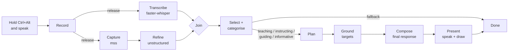

# Hey Arro

**A push-to-talk screen assistant for Windows that answers questions about your screen,
out loud, and points at what it is talking about.**

Hold `Ctrl + Alt`, ask a question about anything on your screen, and release. Hey Arro
works out what kind of help you need and which parts of the screen matter. It plans the
answer, finds each thing it will refer to on the screen, then **speaks the answer while
drawing a pointer, circle, underline, arrow or highlight on each element as it is
mentioned**.


> **Version 0.1.** The first complete end-to-end release: question, screen understanding,
> categorisation, response plan, on-screen coordinates, spoken answer and on-screen marks,
> with a live status indicator throughout.

---

## Table of contents

- [How it works](#how-it-works)
- [The flow, step by step](#the-flow-step-by-step)
- [Question categories](#question-categories)
- [The status indicator](#the-status-indicator)
- [What one interaction produces](#what-one-interaction-produces)
- [Features](#features)
- [Requirements](#requirements)
- [Installation](#installation)
- [Usage](#usage)
- [Configuration](#configuration)
- [Project structure](#project-structure)
- [Architecture](#architecture)
- [Testing](#testing)
- [Performance](#performance)
- [Privacy and data](#privacy-and-data)
- [Troubleshooting](#troubleshooting)
- [Known limitations](#known-limitations)
- [Contributing](#contributing)
- [License](#license)

---

## How it works

One press of `Ctrl + Alt` is one interaction. Every slow step runs off the UI thread.
Each step after capture is isolated: it reads the previous step's file, writes its own,
and fails soft.



| # | Step | Where | Output |
|---|---|---|---|
| 1 | Record | `app/audio` | 16 kHz mono WAV |
| 2 | Transcribe | `app/transcription` | transcript |
| 3 | Capture | `app/capture` | PNG of one monitor |
| 4 | Refine | `app/refinement` | `ss_segment_manifest.json`, `segments/*.png` |
| 5 | Select + categorise | `app/refinement` | `relevant_ss_manifest.json` |
| 6 | Plan | `app/planner` | `response_plan.json` |
| 7 | Ground | `app/grounding` | `plan_pointers.json` |
| 8 | Compose | `app/final_response` | `final_response.json` |
| 9 | Present | `app/final_response` | spoken answer + marks on screen |

---

## The flow, step by step

### 1. Record
Holding `Ctrl + Alt` starts the microphone. A low-level keyboard hook makes this work
while Hey Arro is in the background. Releasing the keys stops the recording and writes a
16 kHz mono WAV. Only one interaction runs at a time: a press is ignored until the
previous answer has finished speaking.

### 2. Transcribe (local)
`faster-whisper` transcribes the recording on your machine. The default is CPU `int8`,
with the language detected automatically. Audio never leaves the computer.

### 3. Capture
At the same moment, `mss` takes one screenshot of the configured monitor (the primary
monitor by default).

### 4. Refine
`unstructured` (hi_res layout detection + Tesseract OCR) splits the screenshot into
**segments**: titles, text blocks, lists, tables, images and similar. Each segment gets a
pixel box, its OCR text and a cropped image. Everything is saved in a new folder for this
screenshot under `screen-segments/`. That includes `screenshot_bounding_boxes.png`, the
segments drawn over the screenshot for inspection.

If refinement fails, the question is not lost. The plain screenshot is saved and the
interaction continues.

### 5. Select the relevant segments and categorise the question
Once the transcript and the refined screenshot are both ready, one Gemini call gets the
full screenshot, the segment manifest (JSON) and the question. It returns two things:

- **The question's category**: teaching, instructing, guiding, informative or fallback,
  with a 0-1 confidence and a one-sentence reason.
- **Only the relevant segments**, each scored 1-10.

The call asks for ids and scores only, never descriptions. This keeps the output, and so
the latency, small. Unknown ids are dropped and values are clamped. A **fallback**
question (small talk, off-screen or unclear) ends here.

### 6. Plan the response
One Gemini call writes a **plan**, not the answer. Its system prompt is a shared brief
plus a section for the category:

- **teaching** builds understanding one idea per step;
- **instructing** gives one action per step, in order, and ends with how to check it worked;
- **guiding** uses 1-3 steps that point at the right element;
- **informative** uses 1-3 steps that list exactly what to report.

The full screenshot is the **main reference**. The relevant segments, with their boxes
and a labelled close-up crop of each, are **supporting references**. A segment is used
only when it actually covers what a step is about. Each step has:

- a `purpose`;
- a `target`, a short description of the element on screen, for example "the Windows
  taskbar Search bar, bottom centre";
- the supporting `segment_ids`, with their boxes copied from the manifest in code;
- a `visual_action`: point, circle, underline, arrow, highlight, draw or none;
- `key_points`, with exact on-screen values such as names, labels, numbers or shortcuts.

The plan also has a goal, an approach and caveats.

### 7. Ground the targets
Each step's `target` is located on the screenshot. This takes one small Gemini call per
step, run in parallel:

- A step with segments is searched in the padded area those segments cover, a closer look
  for precision.
- A step without segments, or whose target was not found in its segment area, is searched
  on the whole screenshot.
- A box that touches the edge of the segment crop may have been cut short, so it is
  searched again on the whole screenshot.

Gemini's `[ymin, xmin, ymax, xmax]` 0-1000 boxes are converted to screenshot pixels and
clamped. Unusable boxes are rejected, never guessed. Each step gets a pixel `box` and a
centre `point`, or `found: false`.

### 8. Compose the final response
One Gemini call turns the plan into the **spoken answer**. The plan is the authority:

- every step is covered, in order, with all of its key points;
- nothing is added beyond the plan;
- the screenshot is used only to read facts a step needs.

Sentences are short and written to be heard. Each one names the plan step it belongs to.
Hey Arro then copies that step's pointer (box and point) onto the sentence **in code**, so
the model never writes coordinates. Opening and closing sentences have no pointer.

### 9. Present: speak and draw
The status indicator shows **Responding** for 2 seconds. Then, for each sentence:

1. The sentence's **mark** is drawn on the screen at its pointer.
2. The sentence is **spoken** with the Windows voice.
3. When the sentence has been said, the next one starts.

The marks are drawn by a transparent, click-through window over the captured monitor.
Screenshot pixels are converted to screen positions, including display scaling.

| Mark | Drawn as |
|---|---|
| `point` | a pointer whose tip sits on the target, with a pulsing ripple |
| `circle` | a ring drawn around the target |
| `underline` | a line drawn under the target |
| `arrow` | an arrow sweeping in from open space to the target's edge |
| `highlight` | a glowing translucent box over the target |
| `draw` | a moving dashed frame where an explanation belongs |

When the last sentence is done, the screen is cleared, the indicator fades out and Hey
Arro is ready for the next question.

---

## Question categories

| Category | The user wants… | Example | Answered as |
|---|---|---|---|
| `teaching` | to understand an idea | *"Explain how linear regression works from this video"* | an explanation, one idea at a time |
| `instructing` | to complete a task | *"How do I export this as a PNG?"* | ordered actions, each on its control |
| `guiding` | to find something / the next move | *"Where is the export button?"* | where it is and why |
| `informative` | a fact shown on screen | *"How many folders are on my screen?"* | the information itself |
| `fallback` | anything else | *"Hello, how are you?"* | not planned |

---

## The status indicator

A glass-style pill at the top of the screen shows what Hey Arro is doing. It has a
tinted translucent body, a sheen, a light rim and an animated orb in the status colour.
It never takes focus and lets clicks through.

| Status | When |
|---|---|
| **Listening** | while `Ctrl + Alt` is held |
| **Transcribing** | after release, while the speech is transcribed |
| **Refining** | while the screen is segmented and the relevant segments are selected |
| **Planning** | while the response is planned, grounded and composed |
| **Responding** | for 2 seconds before the answer starts |
| **Speaking** | while each sentence is spoken and its mark is drawn |

It fades out when the interaction ends, after an error, or after a fallback question.

---

## What one interaction produces

```
screen-segments/
└── screenshot-20261112-112429-c375cd/
    ├── screenshot.png                  the captured screen
    ├── screenshot_bounding_boxes.png   the segments drawn over it
    ├── segments/                       one cropped image per segment
    ├── ss_segment_manifest.json        every segment: id, kind, OCR text, box, crop
    ├── relevant_ss_manifest.json       category, confidence, reason + scored segments
    ├── response_plan.json              goal, approach, ordered steps, caveats
    ├── plan_pointers.json              a pixel box and centre point per step
    └── final_response.json             the spoken sentences, each with its pointer
```

<details>
<summary><b>Example: <code>response_plan.json</code> (abridged)</b></summary>

```json
{
  "query": "Where is the search box on this screen?",
  "response_category": "guiding",
  "goal": "Point out the search boxes visible on the screen.",
  "steps": [
    {
      "order": 1,
      "purpose": "Highlight the Windows system search bar on the taskbar.",
      "target": "the Windows taskbar Search bar, bottom centre next to the Windows start button",
      "visual_action": "point",
      "key_points": ["Windows taskbar search bar", "Located near the bottom center"],
      "segment_ids": [],
      "targets": []
    }
  ],
  "caveats": []
}
```
</details>

<details>
<summary><b>Example: <code>plan_pointers.json</code> (abridged)</b></summary>

```json
{
  "pointers": [
    {
      "order": 1,
      "target": "the Windows taskbar Search bar, bottom centre next to the Windows start button",
      "visual_action": "point",
      "searched": "screenshot",
      "found": true,
      "box": { "left": 657, "top": 1027, "width": 278, "height": 44 },
      "point": { "x": 796, "y": 1049 }
    }
  ]
}
```
</details>

<details>
<summary><b>Example: <code>final_response.json</code> (abridged)</b></summary>

```json
{
  "query": "How do I open a new tab in this window?",
  "response_category": "instructing",
  "sentences": [
    {
      "index": 1,
      "text": "To open a new editor tab, click File at the top and select New File, or press Ctrl+N on your keyboard.",
      "step": 1,
      "visual_action": "point",
      "target": "the File menu in the top-left menu bar",
      "pointer": { "box": { "left": 48, "top": 15, "width": 31, "height": 15 }, "point": { "x": 63, "y": 22 } }
    }
  ],
  "uncovered_steps": []
}
```
</details>

---

## Features

- **Push-to-talk from anywhere**, with one interaction at a time.
- **Local speech recognition.** Audio never leaves your machine.
- **Screen understanding.** The screen is split into labelled segments with boxes, OCR
  text and crops.
- **LLM relevance filtering and question categorisation** in a single small-output call.
- **Category-specific response plans**, with the screenshot first and segments only where
  they help.
- **Grounded coordinates.** Every target is located on the screen, with fallbacks for
  segments that miss or cut it off. Boxes are validated, never invented.
- **A plan-faithful answer.** The final response follows the plan step by step, and
  pointers are attached in code.
- **Spoken answers** with the offline Windows voice.
- **On-screen marks**, synchronised sentence by sentence and accurate under display scaling.
- **A live glass status indicator** from the first key press to the last spoken word.
- **Inspectable.** Every step writes a file into the screenshot's folder and logs in one
  format, `[time][level]: message`.
- **Fails soft.** A failure in any step after capture is logged, and the interaction still
  ends cleanly.
- **Provider-neutral contracts** for every step. The vendor is chosen in one factory per
  package.

---

## Requirements

| | |
|---|---|
| **OS** | Windows 10 / 11 (the global hotkey and the voice are Windows-specific) |
| **Python** | 3.12 (developed on 3.12.10) |
| **Tesseract OCR** | Required by `unstructured`. Install it and make sure `tesseract` is on your `PATH`. |
| **Hardware** | A microphone and speakers |
| **Network** | To download the Whisper and layout models once, and for every Gemini call |
| **API key** | A personal Gemini API key from [Google AI Studio](https://aistudio.google.com/apikey) |

Python dependencies (`requirements.txt`): `PySide6`, `keyboard`, `sounddevice`,
`faster-whisper`, `mss`, `google-genai`, `python-dotenv`, `pyttsx3`, `unstructured[image]`,
`pytest`.

---

## Installation

```bat
:: 1. Get the code
git clone https://github.com/atirek-pro/HeyArro.git
cd HeyArro

:: 2. Create a virtual environment
python -m venv heyarro-env
heyarro-env\Scripts\python.exe -m pip install --upgrade pip

:: 3. Install the dependencies
heyarro-env\Scripts\python.exe -m pip install -r requirements.txt

:: 4. Configure it
copy .env.example .env
```

Open `.env` and set `GEMINI_API_KEY`. Every other setting has a sensible default and is
documented in `.env.example`.

> **Virtual environment note:** `activate.bat` hard-codes the folder it was created in.
> If you move or rename the project, call `heyarro-env\Scripts\python.exe` directly, as
> above, instead of activating.

---

## Usage

```bat
heyarro-env\Scripts\python.exe -m app.main
```

Hey Arro starts in the system tray and logs to the console.

1. Hold **`Ctrl + Alt`**. The indicator shows **Listening**.
2. Ask your question out loud.
3. Release. The indicator moves through **Transcribing**, **Refining** and **Planning**.
   After a short **Responding** pause, Hey Arro **speaks the answer** while marking each
   element on your screen.

The tray icon shows a status summary and quits the app. Errors that end an interaction
also appear as a tray notification.

### Example log (abridged)

```text
[11:25:13][INFO]: [Status] listening
[11:25:15][INFO]: [Status] transcribing
[11:25:15][INFO]: [Status] refining
[11:25:28][INFO]: [Input] transcript: 'How do I open a new tab in this window?'
[11:25:31][INFO]: [Selection] category=instructing (confidence 0.95): The user wants to perform an action.
[11:25:31][INFO]: [Status] planning
[11:25:38][INFO]: Response plan complete: 2 step(s), 5.47s, plan=...\response_plan.json
[11:25:43][INFO]: Plan grounding complete: 2 of 2 located, 5.20s, pointers=...\plan_pointers.json
[11:25:47][INFO]: Final response complete: 2 sentence(s), 3.68s, response=...\final_response.json
[11:25:47][INFO]: [Status] responding
[11:25:49][INFO]: [Presenting] 1/2 (point): To open a new editor tab, click File at the top and select New File...
[11:25:49][INFO]: [Status] speaking
[11:25:58][INFO]: [Presenting] done
[11:25:58][INFO]: [Status] idle
[11:25:58][INFO]: Interaction complete
```

---

## Configuration

All settings live in `.env`. A real environment variable always wins over the file.

**Gemini**

| Setting | Default | Description |
|---|---|---|
| `GEMINI_API_KEY` | *(empty)* | Your personal key, and the only secret the app needs. It is never logged. |
| `GEMINI_MODEL` | `gemini-3.8-flash` | The default model for every Gemini step |
| `GEMINI_TIMEOUT_SECONDS` | `60` | How long to wait for a Gemini call |

**Speech to text (local)**

| Setting | Default | Description |
|---|---|---|
| `WHISPER_MODEL_SIZE` | `base` | `tiny` … `large-v3`; bigger is slower but more accurate |
| `WHISPER_DEVICE` | `cpu` | `cpu` or `cuda` |
| `WHISPER_COMPUTE_TYPE` | `int8` | `int8` for CPU, `float16` for CUDA |
| `WHISPER_LANGUAGE` | *(auto)* | Pin a language (`en`, `de`, …) or leave empty to detect it |

**Screen capture and refinement**

| Setting | Default | Description |
|---|---|---|
| `SCREENSHOT_MONITOR` | `1` | `1` = primary, `2+` = the others, `0` = all combined (no marks) |
| `SCREENSHOT_DIR` | `%TEMP%\clicky-screenshots` | Used only when refinement is off or fails |
| `REFINEMENT_ENABLED` | `true` | Split each screenshot into segments |
| `REFINEMENT_DIR` | `./screen-segments` | Parent folder for the per-screenshot folders |
| `REFINEMENT_STRATEGY` | `hi_res` | `hi_res` (layout model + OCR) · `ocr_only` · `auto` |
| `REFINEMENT_LANGUAGES` | *(default)* | Tesseract language codes, comma separated |
| `REFINEMENT_MIN_SEGMENT_PIXELS` | `16` | Smaller segments are dropped as noise |

**Understanding and answering** (each `*_MODEL` defaults to `GEMINI_MODEL`)

| Setting | Default | Description |
|---|---|---|
| `SEGMENT_SELECTION_ENABLED` | `true` | Categorise the question and select the relevant segments |
| `SEGMENT_SELECTION_THINKING_BUDGET` | `0` | `0` = no thinking (fastest), `-1` = model default |
| `RESPONSE_PLANNING_ENABLED` | `true` | Write a response plan |
| `RESPONSE_PLANNING_THINKING_BUDGET` | `1024` | Thinking tokens for the planner |
| `PLAN_GROUNDING_ENABLED` | `true` | Locate each plan step's target on the screen |
| `PLAN_GROUNDING_THINKING_BUDGET` | `0` | Thinking tokens for grounding |
| `FINAL_RESPONSE_ENABLED` | `true` | Compose the spoken answer from the plan |
| `FINAL_RESPONSE_THINKING_BUDGET` | `0` | Thinking tokens for the final response |

**Presenting the answer**

| Setting | Default | Description |
|---|---|---|
| `RESPONDING_PAUSE_SECONDS` | `2` | How long **Responding** shows before the answer starts |
| `TTS_ENABLED` | `true` | Speak the answer; when off, each mark stays up for its reading time |
| `TTS_RATE_WPM` | *(voice default)* | Speaking speed in words per minute |
| `TTS_VOLUME` | *(unchanged)* | `0.0` - `1.0` |
| `TTS_VOICE_ID` | *(default voice)* | A SAPI voice id |
| `OVERLAY_ENABLED` | `true` | Draw the marks on the screen |
| `STATUS_INDICATOR_ENABLED` | `true` | Show the glass status indicator |

Each understanding step needs the one before it. Without `GEMINI_API_KEY`, Hey Arro still
records, transcribes, captures and refines, and then ends the interaction.

> `LLM_PROVIDER`, `MOCK_LLM_DELAY_SECONDS` and `MAX_SCREENSHOT_BYTES` belong to an earlier
> answer stage kept in `app/llm` and are not used by the current flow. Every setting also
> accepts a `CLICKY_`-prefixed alias from the original prototype.

---

## Project structure

```
app/
├── main.py              composition root: builds every service, the indicator and the tray
├── coordinator.py       sequences one interaction and reports its status
├── pipeline.py          joins the transcript and the screenshot of one interaction
├── status.py            the statuses shown by the indicator
├── config.py            every setting, read from .env / the environment
├── logging_setup.py     the [time][level]: message log format
├── hotkey/              global Ctrl + Alt detection
├── audio/               microphone recording -> 16 kHz WAV
├── transcription/       contract + local faster-whisper provider
├── capture/             contract + mss screen capture
├── refinement/          unstructured segmentation, manifests,
│                        Gemini segment selection + categorisation
├── planner/             per-category prompts + Gemini response planner
├── grounding/           Gemini target -> pixel-box grounding
├── final_response/      Gemini composer, Windows speech, on-screen overlay, presenter
├── llm/                 earlier answer stage (kept, not wired into the flow)
└── ui/                  tray icon + glass status indicator
tests/                   behaviour tests; no key, microphone, voice or model needed
sample_refinement.py     stand-alone script that draws the segments of one screenshot
```

---

## Architecture

- **The coordinator sequences the steps, and the services own the work.**
  `ApplicationCoordinator` decides *when* each step runs and reports an
  `AssistantStatus`. It holds no vendor, prompt or widget code.
- **Contracts first.** Every step sits behind an abstract base class with a result
  dataclass: `TranscriptionProvider`, `ScreenCaptureProvider`, `ScreenRefinementProvider`,
  `SegmentSelector`, `ResponsePlanner`, `PlanGrounder`, `ResponseComposer` and
  `SpeechProvider`. The vendor is chosen in one `create_*()` factory per package.
- **Workers keep the UI responsive.** Every slow call, speech included, runs in a
  `QRunnable` on a `QThreadPool` and reports back through Qt signals.
- **Files are the hand-off between steps.** Each step reads the previous step's JSON from
  the screenshot's folder and writes its own, so any step can be inspected or re-run on
  its own.
- **Models never invent coordinates.** The planner names segment ids, and their boxes are
  copied in code. Grounding converts 0-1000 boxes to pixels and validates them. The final
  response names plan steps, and their pointers are attached in code.
- **Structured output everywhere.** Every Gemini call uses a JSON response schema
  validated with pydantic. Unknown ids and steps are dropped, and values are clamped.
- **Screen text is data.** Prompts tell the model that text in the screenshot is content
  to read, never instructions to follow.

---

## Testing

```bat
heyarro-env\Scripts\python.exe -m pytest tests -q --ignore=tests/test_llm_providers.py
```

The suite (224 tests) replaces the microphone, Whisper, the screen, `unstructured`,
Gemini, the voice and the thread pool with doubles. It needs no API key, hardware or
model download, and nothing is spoken or shown while it runs.

`tests/test_llm_providers.py` belongs to the unwired `app/llm` package. It fails to import
a removed module, which is why it is excluded above.

---

## Performance

These are measured samples on one machine with `gemini-3.8-flash`, not benchmarks:

| Step | Observed |
|---|---|
| Refinement (`unstructured`, hi_res) | ~10-16 s per screenshot |
| Selection + categorisation | ~2.5-4 s |
| Planning | ~3.5-9.5 s (grows with the number of segment crops) |
| Grounding (parallel, per plan) | ~4.5-7 s |
| Composing the final response | ~3-4 s |
| Responding pause | 2 s (configurable) |

Most of the time goes to refinement. Gemini latency is driven mainly by output tokens, so
each call asks for compact structured output.

---

## Privacy and data

- **Audio** is written to `%TEMP%\clicky-recordings` and transcribed locally. It is never
  uploaded.
- **The answer is spoken locally** with the Windows voice.
- **Screenshots** are saved in `screen-segments/`. With a Gemini key configured, **the
  screenshot, crops of the relevant segments and your transcript are sent to Google's
  Gemini API** during selection, planning, grounding and composing.
- **No memory.** Each interaction is independent: no history, no account, no telemetry.
  All outputs are ordinary files you can delete at any time.

---

## Troubleshooting

**`ModuleNotFoundError: No module named 'PySide6'`**
You are running the system Python. Use `heyarro-env\Scripts\python.exe -m app.main` from
the project root.

**Holding `Ctrl + Alt` does nothing**
The hotkey uses a low-level keyboard hook, and some machines require an elevated
terminal. A GPU driver shortcut on `Ctrl + Alt` can swallow the combination.

**Refinement fails with a Tesseract error**
Install Tesseract OCR and make sure `tesseract --version` works in the same terminal.

**Python crashes (access violation) while importing `unstructured` in Git Bash**
`libmagic`'s DLL fails to load under Git Bash. Run from PowerShell or `cmd`.

**`GEMINI_API_KEY is not set` in the log**
Selection, planning, grounding and the final response are disabled until the key is set.

**No voice**
Check that a Windows voice is installed (Settings -> Time & language -> Speech) and that
`TTS_ENABLED=true`. If speech fails, the error is logged and the marks are still shown.

**Marks appear in the wrong place**
Capture and draw on the same monitor (`SCREENSHOT_MONITOR=1` for the primary). Marks are
not drawn when all monitors are captured together (`0`).

**The first answer starts a little late**
The Whisper and layout models download on first use, and the speech engine builds its
cache on its first sentence.

---

## Known limitations

- Windows only, and run from source.
- The status indicator sits at the top centre and can partly cover a mark there.
- A `draw` mark is a dashed frame around where an explanation belongs. No freehand sketch
  is generated.
- All sentences of one plan step share that step's mark.
- No marks are drawn when `SCREENSHOT_MONITOR=0` (all monitors combined).
- A `fallback` question ends without a spoken reply.

---

## Contributing

Issues and pull requests are welcome. Before opening a PR:

1. Keep each step behind its contract. Vendor code belongs only in that step's provider
   module.
2. Add or update tests. The suite must pass without an API key, microphone, voice or model
   download.
3. Run `heyarro-env\Scripts\python.exe -m pytest tests -q --ignore=tests/test_llm_providers.py`.

---

## License

No license has been chosen yet. Until one is added, all rights are reserved by the author.
