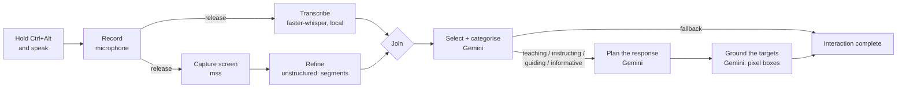

# Hey Arro

**A push-to-talk screen assistant for Windows that understands what you are looking at.**

Hold a hotkey, ask a question out loud about anything on your screen, and Hey Arro works
out *what kind of help you need*, *which parts of the screen matter*, *how to answer* and
*exactly where on the screen each part of the answer belongs*.


> **Project status:** Hey Arro is an early prototype under active development. The
> understanding half of the pipeline is complete: question, screen segmentation,
> categorisation, response plan and on-screen coordinates. The answer itself is not
> generated or shown yet. See [Roadmap](#roadmap-upcoming--pending).

---

## Table of contents

- [How it works](#how-it-works)
- [Features](#features)
- [What one interaction produces](#what-one-interaction-produces)
- [Requirements](#requirements)
- [Installation](#installation)
- [Usage](#usage)
- [Configuration](#configuration)
- [Project structure](#project-structure)
- [Architecture](#architecture)
- [Testing](#testing)
- [Performance](#performance)
- [Privacy and data](#privacy-and-data)
- [Troubleshooting](#troubleshooting)
- [Roadmap (upcoming / pending)](#roadmap-upcoming--pending)
- [Contributing](#contributing)
- [License](#license)

---

## How it works

One press of `Ctrl + Alt` is one interaction. Every stage runs off the UI thread, and
each stage after capture is an isolated step with its own inputs, outputs and failure
handling.



| # | Stage | What happens | Output |
|---|---|---|---|
| 1 | **Record** | Hold `Ctrl + Alt` and speak; release to stop. | 16 kHz mono WAV |
| 2 | **Transcribe** | faster-whisper transcribes locally, with the language auto-detected. | transcript |
| 3 | **Capture** | One screenshot of the configured monitor, in parallel with transcription. | PNG |
| 4 | **Refine** | `unstructured` (hi_res layout + OCR) splits the screenshot into segments such as text blocks, titles, lists, tables and images, and crops each one. | `ss_segment_manifest.json`, `segments/*.png` |
| 5 | **Select + categorise** | One Gemini call gets the screenshot, the segment manifest and the question. It returns the question's category, a confidence and a reason, plus only the relevant segments, each scored 1-10. | `relevant_ss_manifest.json` |
| 6 | **Plan** | One Gemini call with a prompt for that category gets the screenshot, the relevant segments and their close-up crops. It returns a plan of ordered steps, not the answer. | `response_plan.json` |
| 7 | **Ground** | One small Gemini call per plan step, in parallel, finds that step's target on the screenshot and returns a pixel box. | `plan_pointers.json` |

### Question categories

| Category | The user wants… | Example |
|---|---|---|
| `teaching` | to understand an idea or concept | *"Explain how linear regression works from this video"* |
| `instructing` | to complete a task step by step | *"How do I export this as a PNG?"* |
| `guiding` | to find something, or know the next move | *"Where is the export button?"* |
| `informative` | a fact read from the screen | *"How many folders are on my screen?"* |
| `fallback` | anything else: small talk, off-screen or unclear | *"Hello, how are you?"* |

A `fallback` question is not planned or grounded.

---

## Features

- **Push-to-talk from anywhere.** A global `Ctrl + Alt` hotkey works while Hey Arro is
  in the background. One interaction runs at a time, and presses during a run are ignored.
- **Local speech recognition.** Audio is transcribed on your machine with faster-whisper
  and is never uploaded.
- **Screen understanding, not just a screenshot.** The screen is split into labelled
  segments with pixel boxes and OCR text, so later stages can reason about specific
  regions.
- **Relevance filtering by an LLM.** A single, small-output call picks the segments that
  matter for the question. Embeddings, CLIP and a local reranker were evaluated and
  rejected for accuracy.
- **Question categorisation.** Teaching, instructing, guiding, informative or fallback,
  each with a confidence and a reason.
- **Category-specific response plans.** The plan follows the kind of help asked for. A
  teaching plan builds understanding one idea at a time; an instructing plan lists one
  action per step. The full screenshot is the main reference, and segments are only used
  when they improve the plan.
- **Grounded coordinates.** Every plan step names its target in words, and a separate
  step finds it on the screen. When a segment covers the target, the search uses that
  area, padded, for precision. When no segment covers it, or the crop cut the element
  short, the search falls back to the whole screenshot. Unusable boxes are rejected,
  never guessed.
- **Everything is inspectable.** Each screenshot gets its own folder holding the image,
  the crops, both manifests, the plan and the pointers. Every stage logs one structured
  line format: `[time][level]: message`.
- **Fails soft.** A failed refinement continues with the plain screenshot. A failed
  selection, plan or grounding is logged and the interaction still completes.
- **Provider-neutral design.** Each stage depends on an abstract contract
  (`ScreenRefinementProvider`, `SegmentSelector`, `ResponsePlanner`, `PlanGrounder`). The
  vendor is chosen in one place.

---

## What one interaction produces

Each question creates a folder under `screen-segments/`:

```
screen-segments/
└── screenshot-20261112-112429-c375cd/
    ├── screenshot.png                  the captured screen
    ├── screenshot_bounding_boxes.png   the segments drawn over it (for inspection)
    ├── segments/                       one cropped image per segment
    │   ├── segment-001-title.png
    │   └── ...
    ├── ss_segment_manifest.json        every segment: id, kind, OCR text, box, crop file
    ├── relevant_ss_manifest.json       category, confidence, reason + scored segments
    ├── response_plan.json              goal, approach, ordered steps, caveats
    └── plan_pointers.json              a pixel box and centre point for each step
```

<details>
<summary><b>Example: <code>response_plan.json</code> (abridged)</b></summary>

```json
{
  "query": "Where is the search box on this screen?",
  "response_category": "guiding",
  "screenshot_size": { "width": 1920, "height": 1080 },
  "goal": "Point out the search boxes visible on the screen.",
  "steps": [
    {
      "order": 1,
      "purpose": "Highlight the Windows system search bar on the taskbar.",
      "target": "the Windows taskbar Search bar, bottom centre next to the Windows start button",
      "visual_action": "point",
      "key_points": ["Windows taskbar search bar", "Located near the bottom center"],
      "segment_ids": [],
      "targets": []
    }
  ],
  "caveats": []
}
```

`segment_ids` lists the segments that support the step, and `targets` copies their boxes
from the manifest. An empty list means no segment covers the target. The target is then
located from the full screenshot in the grounding stage.
</details>

<details>
<summary><b>Example: <code>plan_pointers.json</code> (abridged)</b></summary>

```json
{
  "plan": "response_plan.json",
  "screenshot_size": { "width": 1920, "height": 1080 },
  "pointers": [
    {
      "order": 1,
      "target": "the Windows taskbar Search bar, bottom centre next to the Windows start button",
      "visual_action": "highlight",
      "searched": "screenshot",
      "found": true,
      "box": { "left": 657, "top": 1027, "width": 278, "height": 44 },
      "point": { "x": 796, "y": 1049 }
    }
  ]
}
```

`searched` says where the target was found: `segments` (the padded segment area) or
`screenshot` (the whole image). A target that cannot be found has `found: false` and no
box.
</details>

---

## Requirements

| | |
|---|---|
| **OS** | Windows 10 / 11 (the global hotkey is Windows-specific) |
| **Python** | 3.12 (developed on 3.12.10) |
| **Tesseract OCR** | Required by `unstructured` for OCR. Install it and make sure `tesseract` is on your `PATH`. |
| **Hardware** | A microphone |
| **Network** | To download the Whisper and layout models once, and for every Gemini call |
| **API key** | A personal Gemini API key from [Google AI Studio](https://aistudio.google.com/apikey) |

Python dependencies (`requirements.txt`): `PySide6`, `keyboard`, `sounddevice`,
`faster-whisper`, `mss`, `google-genai`, `python-dotenv`, `unstructured[image]`, `pytest`.

---

## Installation

```bat
:: 1. Get the code
git clone https://github.com/atirek-pro/HeyArro.git
cd HeyArro

:: 2. Create a virtual environment
python -m venv heyarro-env
heyarro-env\Scripts\python.exe -m pip install --upgrade pip

:: 3. Install the dependencies
heyarro-env\Scripts\python.exe -m pip install -r requirements.txt

:: 4. Configure it
copy .env.example .env
```

Open `.env` and set `GEMINI_API_KEY`. Every other setting has a sensible default and is
documented in `.env.example`.

> **Virtual environment note:** `activate.bat` hard-codes the folder it was created in.
> If you move or rename the project, activation silently falls back to the system Python
> (`ModuleNotFoundError: No module named 'PySide6'`). Calling
> `heyarro-env\Scripts\python.exe` directly, as above, always works.

---

## Usage

Run it from the project root:

```bat
heyarro-env\Scripts\python.exe -m app.main
```

Hey Arro starts in the system tray and logs to the console. Keep the console open,
because it is where the results appear.

1. Hold **`Ctrl + Alt`**.
2. Ask your question out loud.
3. Release. The stages run and log their results. The files appear in
   `screen-segments/<screenshot folder>/`.

The tray icon shows a status summary and quits the app. Errors that end an interaction
are also shown as a tray notification.

### Example log (abridged)

```text
[11:25:13][INFO]: Recording available at C:\...\clicky-recordings\recording.wav
[11:25:13][INFO]: [Refinement] done in 12.41s: 44 segment(s) ...
[11:25:14][INFO]: [Input] transcript: 'Where is the search box on this screen?'
[11:25:14][INFO]: [Input] screenshot: 1920x1080, 245427 bytes, monitor 1, saved to ...
[11:25:16][INFO]: [Selection] category=guiding (confidence 0.95): The user is asking for the location of an interactive element on the screen.
[11:25:16][INFO]: Segment selection complete: 2 relevant, 3.85s, manifest=...\relevant_ss_manifest.json
[11:25:22][INFO]: [Plan] step 1: Highlight the Windows system search bar on the taskbar. (point, segments [])
[11:25:22][INFO]: Response plan complete: 2 step(s), 5.43s, plan=...\response_plan.json
[11:25:27][INFO]: Plan grounding complete: 2 of 2 located, 4.90s, pointers=...\plan_pointers.json
[11:25:27][INFO]: Interaction complete
```

---

## Configuration

All settings live in `.env`. A real environment variable always wins over the file, so
a one-off run can override anything:

```bat
set PLAN_GROUNDING_ENABLED=false && heyarro-env\Scripts\python.exe -m app.main
```

**Gemini**

| Setting | Default | Description |
|---|---|---|
| `GEMINI_API_KEY` | *(empty)* | Your personal key, and the only secret the app needs. It is never logged. |
| `GEMINI_MODEL` | `gemini-3.8-flash` | The default model for every Gemini stage |
| `GEMINI_TIMEOUT_SECONDS` | `60` | How long to wait for a Gemini call before it fails |

**Speech to text (local)**

| Setting | Default | Description |
|---|---|---|
| `WHISPER_MODEL_SIZE` | `base` | `tiny` … `large-v3`; bigger is slower but more accurate |
| `WHISPER_DEVICE` | `cpu` | `cpu` or `cuda` |
| `WHISPER_COMPUTE_TYPE` | `int8` | `int8` for CPU, `float16` for CUDA |
| `WHISPER_LANGUAGE` | *(auto)* | Pin a language (`en`, `de`, …) or leave empty to detect it |

**Screen capture and refinement**

| Setting | Default | Description |
|---|---|---|
| `SCREENSHOT_MONITOR` | `1` | `0` = all monitors combined, `1` = primary, `2+` = the others |
| `SCREENSHOT_DIR` | `%TEMP%\clicky-screenshots` | Used only when refinement is off or fails |
| `REFINEMENT_ENABLED` | `true` | Split each screenshot into segments |
| `REFINEMENT_DIR` | `./screen-segments` | Parent folder for the per-screenshot folders |
| `REFINEMENT_STRATEGY` | `hi_res` | `hi_res` (layout model + OCR) · `ocr_only` · `auto` |
| `REFINEMENT_LANGUAGES` | *(default)* | Tesseract language codes, comma separated |
| `REFINEMENT_MIN_SEGMENT_PIXELS` | `16` | Smaller segments are dropped as noise |

**Selection, planning and grounding**

| Setting | Default | Description |
|---|---|---|
| `SEGMENT_SELECTION_ENABLED` | `true` | Categorise the question and score the segments |
| `SEGMENT_SELECTION_MODEL` | *(GEMINI_MODEL)* | Model for selection |
| `SEGMENT_SELECTION_THINKING_BUDGET` | `0` | Thinking tokens: `0` = none (fastest), `-1` = model default |
| `RESPONSE_PLANNING_ENABLED` | `true` | Write a response plan for planned categories |
| `RESPONSE_PLANNING_MODEL` | *(GEMINI_MODEL)* | Model for planning |
| `RESPONSE_PLANNING_THINKING_BUDGET` | `1024` | Thinking tokens for the planner |
| `PLAN_GROUNDING_ENABLED` | `true` | Locate each plan step's target on the screenshot |
| `PLAN_GROUNDING_MODEL` | *(GEMINI_MODEL)* | Model for grounding |
| `PLAN_GROUNDING_THINKING_BUDGET` | `0` | Thinking tokens for grounding |

Each stage needs the one before it. Without `GEMINI_API_KEY`, the flow still records,
transcribes, captures and refines, and then stops.

> `LLM_PROVIDER`, `MOCK_LLM_DELAY_SECONDS` and `MAX_SCREENSHOT_BYTES` belong to the earlier answer stage. They
> are still read but no longer used by the flow; see [Roadmap](#roadmap-upcoming--pending).
> Every setting also accepts a `CLICKY_`-prefixed alias from the original prototype.

---

## Project structure

```
app/
├── main.py              composition root: builds every service, the hotkey and the tray
├── coordinator.py       drives one interaction and decides WHEN each stage runs
├── pipeline.py          joins the transcript and the screenshot of one interaction
├── config.py            every setting, read from .env / the environment
├── logging_setup.py     the [time][level]: message log format
├── hotkey/              global Ctrl + Alt detection
├── audio/               microphone recording (sounddevice) -> 16 kHz WAV
├── transcription/       contract + local faster-whisper provider
├── capture/             contract + mss screen capture
├── refinement/          contract, unstructured segmentation, manifests,
│                        Gemini segment selection + categorisation
├── planner/             contract, per-category prompts, Gemini response planner
├── grounding/           contract, Gemini target -> pixel-box grounding
├── llm/                 earlier answer stage (kept, not wired into the flow)
└── ui/                  the tray icon (status, quit, error notifications)
tests/                   behaviour tests; no key, microphone or model needed
sample_refinement.py     stand-alone script that draws the segments of one screenshot
```

---

## Architecture

- **The coordinator owns the lifecycle, and services own the work.** `ApplicationCoordinator`
  decides *when* each stage runs. No Whisper, mss, `unstructured` or Gemini code lives in
  it.
- **Contracts first.** Every stage is an abstract base class with a result dataclass:
  `TranscriptionProvider`, `ScreenCaptureProvider`, `ScreenRefinementProvider`,
  `SegmentSelector`, `ResponsePlanner`, `PlanGrounder`. Vendors are chosen in one factory
  per package (`create_*()`).
- **Workers keep the UI responsive.** Every slow call runs in a `QRunnable` on a
  `QThreadPool` and reports back through Qt signals.
- **Files are the hand-off between stages.** Selection writes `relevant_ss_manifest.json`,
  planning reads it and writes `response_plan.json`, and grounding reads that and writes
  `plan_pointers.json`. Each stage can be re-run or inspected on its own.
- **The model never invents coordinates in the plan.** The planner names segment ids, and
  their boxes are copied from the manifest in code. Grounding converts Gemini's 0-1000
  boxes to pixels, clamps them, and rejects unusable ones.
- **Structured, schema-validated output.** Every Gemini call uses a JSON response schema
  validated with pydantic. Unknown ids are dropped, and scores and confidences are clamped.

---

## Testing

```bat
heyarro-env\Scripts\python.exe -m pytest tests -q --ignore=tests/test_llm_providers.py
```

The suite (159 tests) uses fakes for the microphone, Whisper, the screen, `unstructured`
and the Gemini SDK, so it needs no API key, hardware or model download.

`tests/test_llm_providers.py` belongs to the unwired `app/llm` package and currently
fails to import a removed module, which is why it is excluded above.

---

## Performance

Each Gemini stage is one round trip. These are measured samples on one machine with
`gemini-3.8-flash`, not benchmarks:

| Stage | Observed |
|---|---|
| Refinement (`unstructured`, hi_res) | ~10-16 s per screenshot |
| Selection + categorisation | ~2.5-4 s |
| Planning | ~3.5-9.5 s (grows with the number of segment crops) |
| Grounding (parallel, per plan) | ~4.5-7 s |

Most of the time goes to refinement. Gemini latency is driven mainly by output tokens,
which is why selection returns only ids and scores, and the plan carries short key
points rather than prose.

---

## Privacy and data

- **Audio** is written to `%TEMP%\clicky-recordings` and transcribed locally. It is never
  uploaded.
- **Screenshots** are saved in `screen-segments/`. With a Gemini key configured, **the
  screenshot, the crops of the relevant segments and your transcript are sent to
  Google's Gemini API** during selection, planning and grounding.
- **Text on the screen is passed to the model as data.** The grounding prompt tells the
  model to treat on-screen text as content, never instructions.
- **No memory.** Each interaction is independent: no history, no account, no telemetry.
  All outputs are ordinary files you can delete at any time.

---

## Troubleshooting

**`ModuleNotFoundError: No module named 'PySide6'`**
You are running the system Python. Use `heyarro-env\Scripts\python.exe -m app.main` from
the project root.

**Holding `Ctrl + Alt` does nothing**
The hotkey uses a low-level keyboard hook, and some machines require an elevated
terminal. A GPU driver shortcut that also uses `Ctrl + Alt` can swallow the combination.

**Refinement fails with a Tesseract error**
Install Tesseract OCR and make sure `tesseract --version` works in the same terminal.
The interaction still continues with the plain screenshot.

**Python crashes (access violation) while importing `unstructured` in Git Bash**
`libmagic`'s DLL fails to load under Git Bash. Run the app or scripts from PowerShell or
`cmd` instead.

**`GEMINI_API_KEY is not set` in the log**
Selection, planning and grounding are disabled until the key is set in `.env`. Restart
after setting it.

**The first question is slow**
The Whisper and layout models are downloaded on first use.

---

## Roadmap (upcoming / pending)

> This section is for project reference and tracks what is planned next.

### Next in the flow

- [ ] **Final response generation.** One LLM call turns the plan and its pointers into the
      answer: one or more sentences per plan step, each linked to the coordinates it
      points at or draws on.
- [ ] **Fallback answer.** A constant default reply for `fallback` questions, asking the
      user to rephrase as a teaching, instructing, guiding or informative question. It
      needs no LLM call.
- [ ] **Interactive overlay.** Draw the pointer, circle, underline, arrow, highlight or
      drawing for each sentence on screen, in sync with the response, for an interactive
      learning experience.
- [ ] **Screen coordinate mapping.** Convert screenshot pixels to screen coordinates,
      including the monitor offset and display scaling, before anything is drawn.

### Hardening and quality

- [ ] Tell the planner prompt to treat on-screen text and the transcript as data (prompt
      injection). The grounding prompt already does.
- [ ] Validate each plan against its category, for example the step count for
      `guiding` and `informative`.
- [ ] Live evaluation across more screen types (video players, design tools, IDEs, dense
      UIs), at least one question per category.
- [ ] Add saved real Gemini responses as test fixtures, so a change in response shape is
      caught.
- [ ] Measure and reduce end-to-end latency, especially refinement and planning with many
      crops.
- [ ] Confirm the planner's thinking budget is honoured and worth its latency.

### Housekeeping

- [ ] Remove or rework the unwired `app/llm` package, `LLM_PROVIDER` and
      `tests/test_llm_providers.py`.
- [ ] Add a license.
- [ ] Packaging and an installer. Hey Arro is currently run from source.

---

## Contributing

Issues and pull requests are welcome. Before opening a PR:

1. Keep each stage behind its contract. Vendor code belongs only in that stage's provider
   module.
2. Add or update tests. The suite must pass without an API key, microphone or model
   download.
3. Run `heyarro-env\Scripts\python.exe -m pytest tests -q --ignore=tests/test_llm_providers.py`.

---

## License

No license has been chosen yet. Until one is added, all rights are reserved by the
author. Add a `LICENSE` file before distributing or publishing this project.
